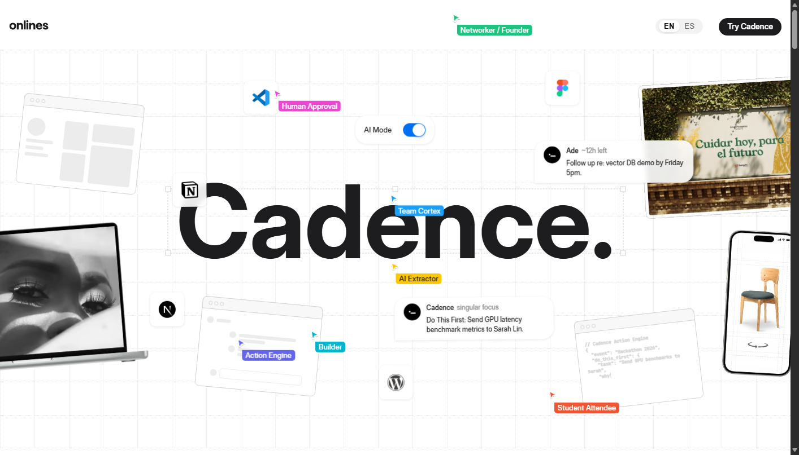

# Cadence — After The Event

> **The Event Ends. The Opportunities Shouldn't.**  
> A high-performance, pixel-perfect interactive web application frontend matching the design aesthetics of modern collaborative creative software, built by **Team Cortex** (*Divyansh Somani, Kaustubh Chowdhury, Anushka Verma, Saiyam Aggarwal*).



---

## ✨ Features & Interactive Systems

1. **Hero Canvas & Collaborative Figma Experience**:
   - **Central Display**: Large, bold `Cadence.` title encased in an interactive bounding box with transform handles that automatically measures and highlights the brand.
   - **Animated Multiplayer Cursors**: Live multiplayer cursors (`Builder`, `Student Attendee`, `Networker / Founder`, `Action Engine`, `Human Approval`, `Team Cortex`, `AI Extractor`) with smooth waypoint trajectories and click bursts.
   - **Interactive Grid System**: Dotted / dashed canvas grid with cell hover glow and trail effects (`grilla-celdas`).
   - **Live Code Typing Editor**: Animated code block typing Cadence's structured JSON action output and priority schema in real time.
   - **Interactive AI Mode Switch**: Toggle switch positioned right above `Cadence.` with fluid animation between active blue and neutral states.
   - **Floating Parallax Elements & Real Notifications**: Live action engine notifications (`Do This First: Send GPU latency benchmark metrics to Sarah Lin`, `Follow up re: vector DB demo by Friday 5pm`).

2. **Interactive Cadence Action Engine Modal**:
   - One-click trigger from buttons across the page (`Try Cadence`, `Try Quick Capture`, `Explore Working Prototype`).
   - Input voice memos, whiteboard photos, or quick meeting notes.
   - Simulates real-time AI extraction producing structured, validated follow-up actions with priority scoring and one-click execution.

3. **Problem & Insight Typography Reveal**:
   - Dynamic viewport scroll opacity revealing: *"The problem is not a lack of inspiration — it's the difficulty of turning inspiration into consistent action."*
   - Smooth word-by-word reveal calibrated for responsive viewport heights.

4. **Core Pillars & Action Engine**:
   - **01 · Capture & Guided Reflection**: Voice memos, whiteboard snaps, and fragmented raw notes.
   - **02 · AI Extraction & 'Do This First'**: Priority scoring and singular focus to beat the 48-hour cliff.
   - **03 · Remember People & Follow-Through**: Contextual notes and ready-to-send draft messages.

5. **Dark Mode Shift (Trust & Human-in-the-Loop)**:
   - Interactive dark mode trigger shifting the canvas into deep black mode.
   - Core philosophy: *"If AI proposes it, you decide it. Every suggested item must pass human review."*

6. **Team Cortex Showcase**:
   - Widespread 4-quadrant grid layout featuring:
     - **Divyansh Somani** — Product Architect
     - **Kaustubh Chowdhury** — AI Systems & Pipeline Architect
     - **Anushka Verma** — UI/UX Designer & Product Lead
     - **Saiyam Aggarwal** — Full-Stack Engine & AI Integration
   - Live multiplayer comment bubbles and interactive "Connect with us" action.

7. **User Personas & Momentum Showcase**:
   - Fanned card deck for **The Student Attendee**, **The Builder / Early Pro**, and **The Networker / Founder**.

---

## 🚀 Getting Started

You can run Cadence locally using any static web server:

### Option 1: Python HTTP Server (Built-in)
```bash
npm start
# or directly:
python -m http.server 3000
```
Then open **`http://localhost:3000`** in your browser.

### Option 2: Node Serve
```bash
npx serve .
```

---

## 📁 Project Structure

```
cortex hackathon/
├── index.html              # Semantic HTML5 entry with interactive Cadence modal
├── package.json            # Project manifest and dev server runner scripts
├── README.md               # Product overview and documentation
├── .gitignore              # Ignored build & environment files
├── assets/                 # All optimized WebP, AVIF, and SVG assets & team portraits
├── fonts/                  # Inter Display and JetBrains Mono WOFF2 font files
├── css/                    # Modular stylesheets (hero, dark mode, team, services, swiper)
│   ├── home-hero.css
│   ├── theme-inline.css
│   ├── styles.css
│   ├── home-bloque-dark-mode.css
│   ├── home-equipo.css
│   ├── home-portfolio.css
│   ├── card-servicio.css
│   ├── home-contacto.css
│   └── swiper.min.css
├── js/                     # Interactive scripts, Lenis smooth scroll, Swiper
│   ├── home-hero-view.js
│   ├── grilla-celdas-view.js
│   ├── shader-halftone-view.js
│   ├── home-quote-block-view.js
│   ├── home-bloque-dark-mode-view.js
│   ├── header-logo-view.js
│   ├── scripts.js
│   └── lenis.min.js
└── previews/               # Full visual rendering screenshots of all sections
```
